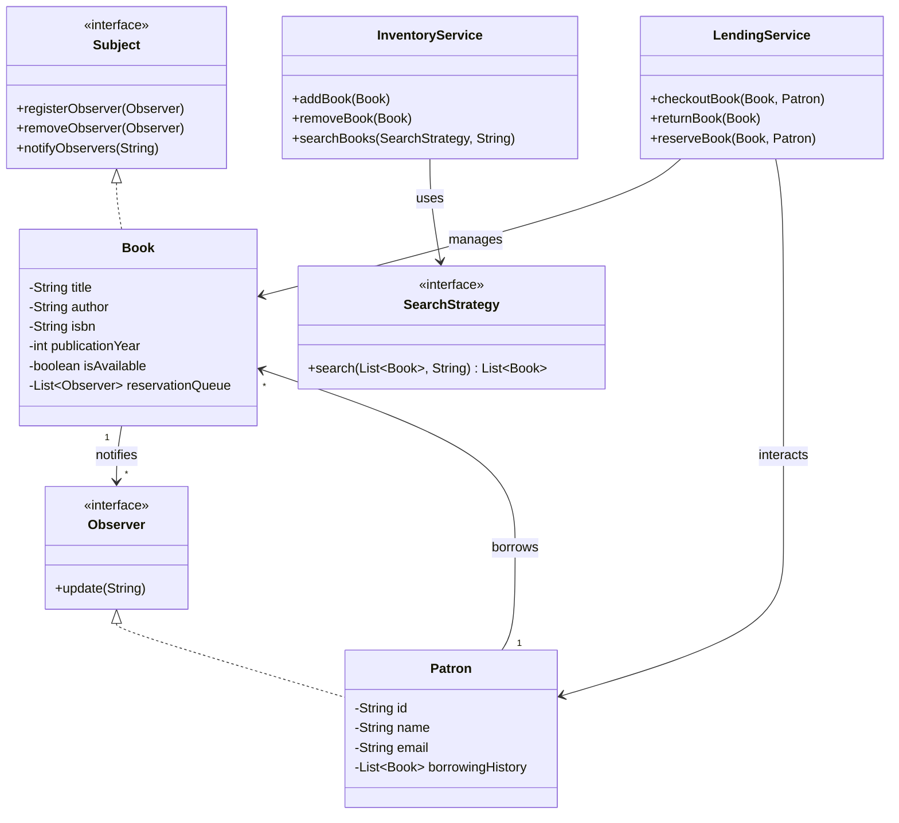

# Library Management System

A Java-based Library Management System designed following Object-Oriented Programming (OOP) concepts, SOLID principles, and relevant design patterns.

## Features Implemented
- **Book Management:** Add, remove, update, and search books by title, author, or ISBN.
- **Patron Management:** Manage library members and track their borrowing history.
- **Lending Process:** Handle checkout and returning of books.
- **Inventory Management:** Track available and borrowed books.
- **Reservation System (Optional Extension):** Allows patrons to reserve a book that is currently checked out, notifying them when it becomes available.

## Design Patterns Used
1. **Observer Pattern:** Used in the Reservation System. The `Book` acts as the `Subject` and `Patron` acts as the `Observer`. When an unavailable book is returned, the observing patrons are notified.
2. **Strategy Pattern:** Used for searching books. The `SearchStrategy` interface allows swapping between different search algorithms (`SearchByTitle`, `SearchByAuthor`, `SearchByIsbn`) at runtime.
3. **Factory Pattern:** The `BookFactory` encapsulates the logic of creating new `Book` instances.

## SOLID Principles Applied
- **Single Responsibility Principle (SRP):** Distinct classes for managing distinct responsibilities (e.g., `InventoryService` manages books, `LendingService` handles checkout/returns).
- **Open/Closed Principle (OCP):** The system can easily introduce new search strategies by adding classes implementing `SearchStrategy` without modifying the core `InventoryService`.
- **Liskov Substitution Principle (LSP):** Interfaces like `SearchStrategy` or `Observer` can be substituted with any of their implementers without breaking behavior.
- **Interface Segregation Principle (ISP):** Small, focused interfaces like `Observer` and `Subject` prevent implementing classes from taking on methods they don't need.
- **Dependency Inversion Principle (DIP):** Services depend on abstractions (e.g., `SearchStrategy`) rather than concrete implementations.

## Class Diagram Overview



## How to Run

### Using Maven (Recommended)
This project uses Maven for dependency management (primarily for `slf4j` and `logback` logging).
If you have Maven installed, simply run:
```bash
mvn clean compile exec:java -Dexec.mainClass="com.library.Main"
```

### Using standard Java (If Maven is not installed)
If you don't have Maven, you can compile and run it directly. Note that SLF4J will default to a no-operation (NOP) logger implementation without the jar dependencies.

1. **Compile the code:**
```powershell
javac -d out src/main/java/com/library/models/*.java src/main/java/com/library/patterns/observer/*.java src/main/java/com/library/patterns/factory/*.java src/main/java/com/library/patterns/strategy/*.java src/main/java/com/library/services/*.java src/main/java/com/library/Main.java
```

2. **Run the application:**
```powershell
java -cp out com.library.Main
```
